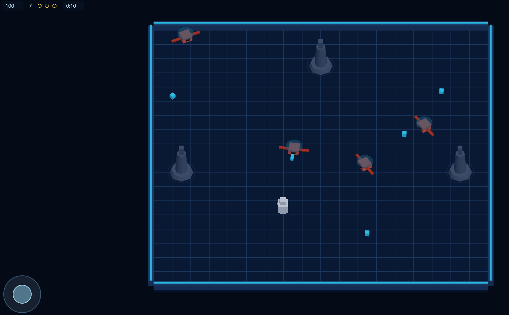
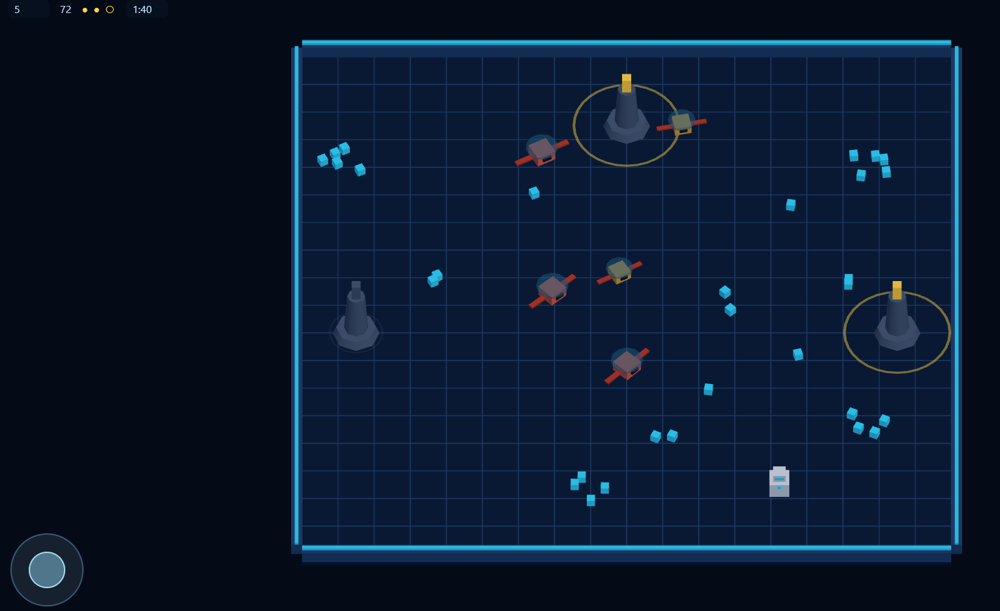
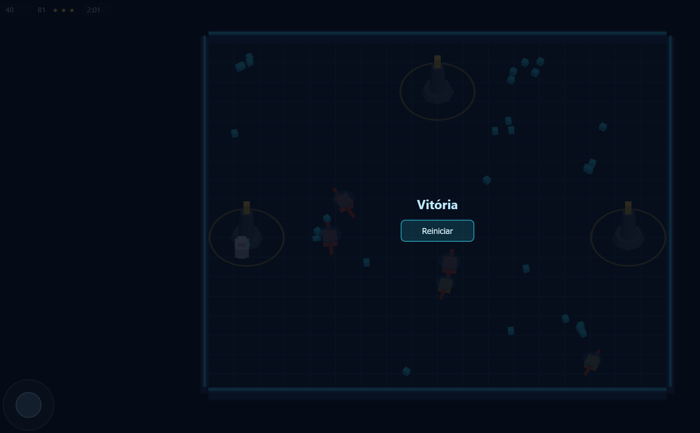

# 🔦 Farol Zero

> **Um jogo 3D inteiramente desenvolvido com IA local — sem API pay-per-use, sem login, sem nuvem.**

Farol Zero é um jogo de ação e estratégia em arena 3D onde você controla um robô de manutenção precisa coletar cristais de energia e reativar três faróis tecnológicos espalhados por uma ilha abandonada, tudo enquanto drones hostis tentam impedir sua missão.

**Vitória** ao acender os 3 faróis. **Derrota** ao Zerar sua vida.

---

## 🎮 Jogue Agora

### Pré-requisitos
- [Node.js](https://nodejs.org/) 18+
- Um navegador moderno (Chrome, Firefox, Edge)
- Opcional: celular na mesma rede Wi-Fi

### Instalação

```bash
# Clone o repositório
git clone https://github.com/SEU-USUARIO/farol-zero.git
cd farol-zero

# Instale as dependências
npm install
```

### Como rodar

```bash
npm start
```

Abra [http://localhost:3000](http://localhost:3000) no navegador.

**No celular** (mesma rede Wi-Fi): abra `http://IP-DO-SEU-PC:3000` no navegador do celular.

---

## 🎯 Como Jogar

| Plataforma | Controle |
|---|---|
| **Desktop** | WASD ou Setas para mover · Mira automática |
| **Celular** | Joystick virtual (arraste) · Toque para mover |

### Objetivo
1. Colete **cristais de energia** (pontos ciano no chão) — o robô começa com 6 cristais
2. Mate **drones inimigos** (corais) para coletar mais cristais (cada drop 5 cristais)
3. Fique parado dentro da área de um **farol** com saldo ≥ 8 cristais por **2 segundos** para ativá-lo
4. Acenda os **3 faróis** para vencer

### Dicas
- Drones atacam por contato — use o terreno a seu favor
- Cristais soltos têm limite de 30 no campo — planeje suas rotas
- Sair da área de um farol cancela seu progresso — não saia até acender!

---

## 🏗️ Stack Técnica

- **Three.js** (r186) — motor 3D com WebGL, sombras PCF soft, tone mapping ACES
- **Vanilla JS ES Modules** — zero frameworks, zero bundlers
- **Node.js** — servidor de dev leve com CORS local
- **Testes unitários** — Node.js com asserts nativos (fase por fase)

### Arquitetura

```
farol-zero/
├── index.html          # Página principal
├── style.css           # Estilização responsiva (mobile-first)
├── server.mjs          # Servidor de dev local
├── package.json        # Dependencies: three@0.186
├── src/
│   ├── main.js         # Loop principal + gerenciamento de estados
│   ├── config.js       # Configurações de gameplay (balanceamento)
│   ├── world.js        # Cena, iluminação, câmera
│   ├── player.js       # Movimento, câmera, limites
│   ├── combat.js       # Disparo automático, projéteis
│   ├── enemies.js      # Spawn, IA de perseguição, dano
│   ├── objectives.js   # Cristais, faróis, vitória
│   └── ui.js           # HUD, menu, overlays
├── tests/
│   ├── phase*-check.mjs   # Testes de regressão por fase
│   └── frame-check.mjs    # Verificações de frame
└── vendor/
    └── three.module.js    # Three.js (pinned)
```

---

## 🤖 Desenvolvido com IA Local

Este é o diferencial do projeto: **todo o código foi escrito com a ajuda de um LLM rodando localmente**, provando que é possível desenvolvimento de software sério sem depender de serviços cloud.

### Configuração de Hardware
| Componente | Especificação |
|---|---|
| **CPU** | Intel i7-3770K @ 3.5GHz (8MB cache) |
| **GPU** | NVIDIA RTX 2060 (12GB VRAM) |
| **RAM** | 16GB DDR3 |

### Configuração do Modelo
```
Modelo:    Qwen-3.8 27B Q3-XXS
Loader:    Ollama
Quantização: Q3-XXS (extremamente comprimida)
Harness: Pi
```

### O pipeline de desenvolvimento
1. Eu descrevia o próximo passo do jogo em linguagem natural
2. O **pi harness** orquestrava a geração do código pelo Qwen local
3. O modelo gerava código, eu validava, e iterávamos

### O que isso prova?
- Modelos quantizados de ~27B podem ser **sérios colaboradores de programação**
- Com GPU dedicada (12GB VRAM), é possível rodar modelos potentes localmente
- O custo de desenvolvimento com IA local é **zero** — é tudo offline
- A qualidade do código gerado permite entregas funcionais e testáveis

---

## 🧪 Testes

```bash
# Executar todos os testes de regressão
node tests/phase4-check.mjs
node tests/phase3-check.mjs
node tests/phase2-check.mjs
```

Todos os testes passam ✅ — cobrindo arena, combate, objetivos e estados do jogo.

---

## 🚀 Roadmap (Fases planejadas)

| Fase | Conteúdo | Status |
|------|----------|--------|
| 1 | Arena, câmera, controles (WASD + joystick) | ✅ Completo |
| 2 | Menu, pausa, HUD, cronômetro, reinício | ✅ Completo |
| 3 | Combate mínimo: drones perseguidores | ✅ Completo |
| 4 | **Objetivo completo:** cristais, faróis, vitória | ✅ Completo |
| 5 | Pressão contínua (novas ondas, escalonamento) | 📝 Planejado |
| 6 | Melhorias durante a partida (escolhas estratégicas) | 📝 Planejado |
| 7 | Legibilidade, partículas, feedback visual | 📝 Planejado |
| 8 | Validação em celular, balanceamento final | 📝 Planejado |

## 📸 Screenshots





---

---

## 📜 Licença

Este projeto é software livre. Sinta-se à vontade para estudar o código, forkar e adaptar.

---

## 🙌 Créditos

Criado por Ambrosio (https://github.com/Ambrosios13) com assistência do modelo **Qwen 3.8 27B Q3-XXS** via Ollama + pi harness.

Hardware: [Sua configuração de PC]

---

*"O futuro do desenvolvimento de software não está em nuvem — está na sua mesa."*
